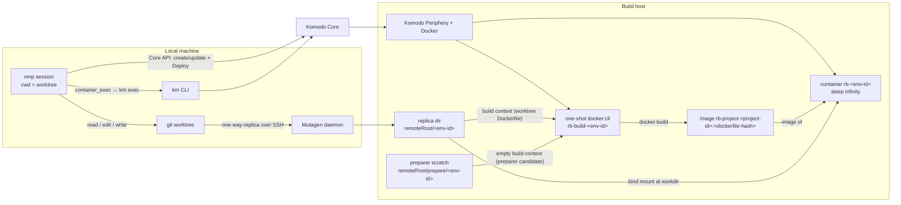
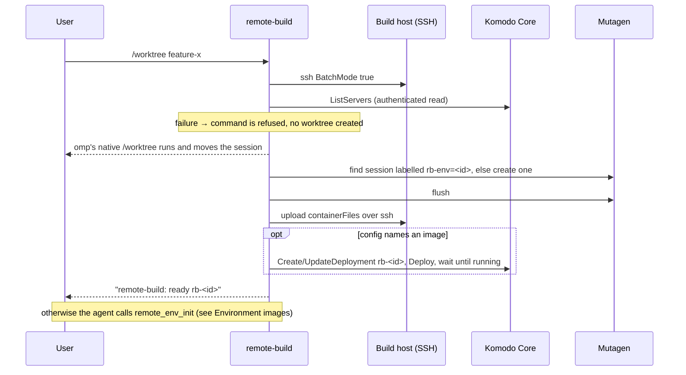

# omp-remote-build

English | [简体中文](README.zh-CN.md)

An [Oh My Pi (`omp`)](https://github.com/can1357/oh-my-pi) plugin that gives every git worktree its own build/test environment on a remote Docker host:

- a **Mutagen one-way-replica** session mirrors the local worktree to the build host;
- a **Komodo Deployment** runs a long-lived container on that host with the replica bind-mounted as its working directory;
- a **project image** holds the project's toolchain and dependencies: a ready image named in the config, the worktree's Dockerfile, or an Arch Linux image prepared once by a subagent and published into the repository as `.omp/remote-build.Dockerfile`. The build host only caches built images, keyed by Dockerfile content, and every worktree with the same Dockerfile reuses them;
- **`remote_env_init`** prepares the worktree's container from that image and runs the project's bootstrap command;
- four **`container_*` tools** give the agent an interactive PTY inside that container.

The agent keeps editing files locally with its normal tools. It compiles, tests and runs things on the remote machine through the container tools. Every tool call that could have changed files is followed by a Mutagen flush, so the container sees the edit before the agent's next step.

Projects opt in with one file, `.omp/remote-build.json`. Projects without it are never touched.

## How it works



### Environment lifecycle



- **Identity.** An environment belongs to one absolute worktree root. Its id is `<slug>-<hash>`: a slug of the directory name plus 10 hex chars of the SHA-256 of the canonical root path. The Mutagen session is `rb-<id>`, labelled `remote-build` and `rb-env=<id>`. The replica lives at `<remoteRoot>/<id>`, and the Komodo Deployment and its container are both named `rb-<id>`. A project is all worktrees of one repository; its id is derived the same way from the main checkout's path. A project image is tagged `rb-project-<project-id>:<first 16 hex chars of the Dockerfile's SHA-256>`, so an existing tag is always a build of exactly that Dockerfile.
- **Authority.** The repository owns the environment definition: `.omp/remote-build.json` and the Dockerfile it names, including a prepared `.omp/remote-build.Dockerfile`. Mutagen's daemon decides whether a session exists (looked up by label), Komodo Core decides whether a Deployment exists and is running, and the build host's Docker daemon decides whether an image exists. Built images are only a cache: the build host prunes images no container uses, and the plugin rebuilds a missing one from the Dockerfile. The plugin keeps no state of its own on the build host. Re-preparing is idempotent: an existing session is reused, a Deployment whose managed fields already match and whose container is running is left alone, and a drifted one is updated and redeployed.
- **When an environment is prepared:**
  - after `/worktree` (or `/wt`) moves the session into a new worktree of an opted-in project;
  - at session start inside a non-main worktree that already has a Mutagen session (reopening or resuming a session there);
  - at session start of an **isolated subagent** (`task` with `isolated: true`), whose separate workspace gets its own environment;
  - on the first call of `remote_env_init` or a `container_*` tool in a worktree of an opted-in project that has no environment in this session yet.
  The main checkout never gets an environment; remote environments are a worktree feature. Preparation syncs the worktree and, for a configured `image`, ensures the container. With any other image source the container belongs to `remote_env_init`.
- **Gating.** While an environment is `preparing`, every tool call in that worktree waits for it. If preparation `failed`, every tool call there is blocked and the error is returned as the block reason. Restart the session after fixing the cause.
- **Flushing.** After each tool result, the plugin runs `mutagen sync flush` unless the tool is known not to write: `read`, `grep`, `glob`, `ast_grep`, `web_search`, `todo`, `ask`, `ctx`, `wait`, the four `container_*` tools, and `remote_env_build_image` (it only builds on the build host). Everything else (`edit`, `write`, `eval`, `exec_command`, `bash`, `task`, `remote_env_init`, …) counts as a potential write, because its side effects are unknown or, for `remote_env_init`, because it publishes prepared files.

### Environment images

`remote_env_init` resolves the project image, recreates the worktree container `rb-<id>` from it, and runs the bootstrap command. It reads `image`, `dockerfile` and `bootstrap` from `.omp/remote-build.json` on every call; the other fields keep the values the environment was prepared with until the next session.

|Source|When|Image|
|---|---|---|
|configured|config sets `image`|that image, used as is; never built|
|worktree Dockerfile|config `dockerfile`, else the first regular file of `.devcontainer/Dockerfile`, `Dockerfile` in the worktree|`rb-project-<project-id>:<hash>`: reused when the tag exists, otherwise built with the synced worktree replica as build context|
|preparer subagent|no Dockerfile in the worktree|prepared by a subagent and published as the worktree Dockerfile `.omp/remote-build.Dockerfile`, see below|

`rebuild: "image"` builds the Dockerfile even when its tag exists, for example after upstream packages changed. `rebuild: "prepare"` runs the preparer again and replaces `.omp/remote-build.Dockerfile`; it is refused when the worktree Dockerfile is hand-written. Editing a Dockerfile needs neither: a different content hash is a different tag, built on the next call.

Then every call recreates the container from the image (open container sessions end) and, when the config sets `bootstrap`, runs it with `<shell> -c` in the working directory of a one-shot container `rb-boot-<id>` with the same mounts and environment. It is meant for per-worktree state inside the mount, such as `bun install`, and must be idempotent.

**Builds.** Periphery runs in a container that cannot see `remoteRoot`, so image builds do not use Komodo Builds. Each build is a one-shot Deployment of `docker:cli`, named `rb-build-<id>`, that mounts the host's Docker socket and the build context and runs `docker build`. Whenever a stage of the Dockerfile is `FROM rb-base-archlinux:latest` and that image is missing (it is pruned like any unused image), the plugin builds it first from [`images/archlinux.Dockerfile`](images/archlinux.Dockerfile): Arch Linux with `base-devel`, `git`, `sudo` and `paru`. Build and bootstrap containers run once with restart policy `no`, and their Deployments are reused by the next run.

**Preparer subagent.** Without a Dockerfile, `remote_env_init` ensures the base image, deploys the worktree container from it, and runs a `remote-env-preparer` subagent in the worktree with the session's model. The subagent reads the project, experiments in the container, and calls `remote_env_build_image` with a Dockerfile whose final stage is `FROM rb-base-archlinux:latest`, with no `COPY` or `ADD`, and a bootstrap command. It installs official packages with `pacman` and AUR packages with `paru`, choosing the `-bin` variant whenever one exists. `remote_env_build_image` builds a candidate image from an empty scratch context `<remoteRoot>/prepare/<id>/`, recreates the container from it and runs the bootstrap command; the last successful candidate is kept in that scratch directory. The subagent finishes once the project's build and tests pass in that container. Only when its final answer says `result: success` does `remote_env_init` publish into the worktree, each file by atomic rename and the config last:

|File|Content|
|---|---|
|`.omp/remote-build.Dockerfile`|the last successful candidate Dockerfile, byte for byte, so its tag is the image already built|
|`.omp/remote-build.preparer.md`|the subagent's final answer, headed by the SHA-256 of the Dockerfile it describes|
|`.omp/remote-build.json`|`dockerfile` set to `.omp/remote-build.Dockerfile`, `bootstrap` set or removed; every other field kept, rewritten as 2-space JSON|

The scratch directory is removed afterwards. Commit the three files: worktrees and build hosts that have them reuse or rebuild the image from them without preparing again. A worktree checked out without them, for example from a branch the files were not merged into, runs the preparer itself. Later reports show `.omp/remote-build.preparer.md` and add a `note` when the Dockerfile has changed since the report was written. `remote_env_build_image` is only available to the preparer, and the preparer cannot call `remote_env_init`.

**Report.** `remote_env_init` returns `key: value` lines for the agent: `status` (`ready` or `failed`), `worktree`, `project`, `container`, `image`, `image_source`, `persisted`, `base_image`, `note`, `build_output_tail`, `bootstrap`, `bootstrap_exit_code`, `bootstrap_output_tail`, `preparer_report`, `usage`, and on failure `error`. Fields that do not apply are omitted. Output tails are cut to 80 lines or 8 KiB. A failed init returns the same report as a tool error, so every completed step is visible.

### What is synced

The replica is one-way: local → remote. Files the container creates (build output, caches) stay remote and are never copied back. `.git` is never synced. Git's active ignore sources are translated into Mutagen ignore patterns: `core.excludesFile` (default `$XDG_CONFIG_HOME/git/ignore`), `.git/info/exclude`, and every `.gitignore` in non-ignored directories, with `core.ignoreCase` honoured. Tracked files that match an ignore rule are still synced. Ignored build output therefore does not travel; it is rebuilt in the container. On top of that:

- `ignore` adds Mutagen patterns;
- `include` re-includes paths git ignores but the container needs;
- `containerFiles` targets are excluded from sync and uploaded separately, so a file can exist only on the remote side (for example a container-specific tool config).

The ignore set is fixed when the Mutagen session is created. After changing ignore rules, terminate the session (see [Cleanup](#cleanup)) so the next preparation recreates it.

## Requirements

|Component|Notes|
|---|---|
|`omp`|Plugins are loaded from `~/.omp/plugins`. Developed against `@oh-my-pi/pi-coding-agent` 18.6.|
|[`omp-unified-exec`](https://github.com/oh-my-omp/omp-unified-exec)|Installed as an omp plugin. The container tools reuse its current `ExecSession` API, rendered terminal observations and escape decoding, imported as `omp-unified-exec/src/*`, so the package must be installed under that name next to this plugin.|
|A working PTY provider|The omp host must provide Bun's native `Bun.Terminal`. Before checking or opening a container terminal, `container_exec` calls `omp-unified-exec`'s runtime admission check. If the host lacks that capability, it reports `Container PTY unavailable` with the runtime requirement; the rest of the plugin still works.|
|[Mutagen](https://mutagen.io)|`mutagen` CLI locally. Its daemon starts on demand. It reaches the build host over SSH and installs its agent there automatically.|
|SSH|Non-interactive key-based access to the build host (`ssh -o BatchMode=yes <host> true` must succeed).|
|[Komodo](https://komo.do) Core + Periphery|Core reachable from the local machine. The build host is registered as a Komodo **Server**, with Periphery running and a Docker daemon available. Developed against Komodo v2.2.|
|`km` (komodo-cli)|Used for the container terminal (`km exec`). Its config file also supplies the Core URL and API credentials the plugin uses, so both paths share one source.|
|`git`, Bun|`git` for worktree discovery and ignore translation. Bun comes with omp.|
|Registry and AUR access from the build host|Image builds pull `docker:cli`, the images named in Dockerfiles, and `archlinux:latest`; the base image clones `paru` from the AUR and compiles it (the `paru-bin` binary links an older `libalpm` than current pacman ships).|

**Komodo permissions.** The API key in the km profile must be able to read Servers, Deployments and Updates; inspect Docker images and containers and read container logs on the build host's Server; create and update Deployments; execute `Deploy`; and open container terminals on that Server.

## Install

```bash
omp install https://github.com/oh-my-omp/omp-unified-exec   # dependency, once
omp install https://github.com/oh-my-omp/omp-remote-build
```

GitHub installs track the default branch; re-run the same `omp install <url>` to update. Restart `omp` after installing or updating.

Then create the two config files described below and restart `omp`.

## Configuration

### 1. Host config (per user): `~/.omp/agent/remote-build.json`

The file lives in omp's agent directory: `~/.omp/agent` by default, or wherever omp's agent dir points for the active profile. It describes the single build host. It is read again on every check, so edits apply without restarting omp. An example is in [`examples/remote-build.host.json`](examples/remote-build.host.json):

```json
{
  "ssh": "build-host",
  "remoteRoot": "/srv/remote-build",
  "komodo": {
    "profile": "build",
    "server": "build-host",
    "cliConfig": "~/.config/komodo/komodo.cli.toml"
  },
  "bin": {
    "km": "km",
    "mutagen": "mutagen"
  }
}
```

|Field|Required|Default|Meaning|
|---|---|---|---|
|`ssh`|yes|—|SSH destination of the build host: an alias from `~/.ssh/config` or `user@host`. Used by `ssh` and as the Mutagen beta endpoint (`<ssh>:<remoteRoot>/<id>`).|
|`remoteRoot`|yes|—|Absolute directory on the build host that holds one replica per environment. The Docker daemon managed by Periphery bind-mounts paths below it, so it must be a host path that daemon can access.|
|`komodo.profile`|yes|—|`[[profile]]` `name` or one of its `aliases` in `komodo.cliConfig`.|
|`komodo.server`|yes|—|Name of the Komodo Server (Periphery) that runs the containers.|
|`komodo.cliConfig`|no|`~/.config/komodo/komodo.cli.toml`|km CLI config file. A leading `~/` is expanded. It must be a single file: km's directory, keyword and environment-variable config merging is not reproduced.|
|`bin.km`|no|`km`|km executable. Bare names resolve through `PATH`. Use an absolute path if omp starts without your shell's `PATH`.|
|`bin.mutagen`|no|`mutagen`|Mutagen executable, same resolution rules.|

Unknown fields are rejected.

The referenced km profile looks like this. The plugin reads `host`, `key` and `secret` and never prints them:

```toml
[[profile]]
name = "build"
host = "https://komodo.example.com"
key = "K-..."
secret = "S-..."
```

### 2. Project opt-in (per repository): `.omp/remote-build.json`

Commit this at the repository root. Every worktree of the repository then carries it. An example is in [`examples/project.remote-build.json`](examples/project.remote-build.json):

```json
{
  "image": "rust:1-bookworm",
  "workdir": "/workspace",
  "shell": "bash",
  "ignore": ["*.log"],
  "include": [".env.build"],
  "containerFiles": {
    ".cargo/config.toml": ".omp/container-cargo-config.toml"
  },
  "volumes": ["rb-cargo-registry:/usr/local/cargo/registry"],
  "env": {
    "CARGO_TARGET_DIR": "/workspace/target"
  }
}
```

|Field|Required|Default|Meaning|
|---|---|---|---|
|`image`|no|—|Ready container image of the build/test container. The container is deployed automatically when the environment is prepared, and `remote_env_init` redeploys it. Mutually exclusive with `dockerfile`.|
|`dockerfile`|no|probe `.devcontainer/Dockerfile`, then `Dockerfile`|Repo-relative Dockerfile of the project image, built by `remote_env_init` with the worktree as context. Without `image`, `dockerfile` and a Dockerfile in the worktree, a subagent prepares the image and sets this field to `.omp/remote-build.Dockerfile` (see [Environment images](#environment-images)).|
|`bootstrap`|no|none|One-line shell command run with `<shell> -c` in the working directory of a fresh container after every `remote_env_init` deployment, for example `bun install`. A prepared image sets it to the preparer's command.|
|`workdir`|no|`/workspace`|Absolute path in the container where the replica is mounted; also the container's working directory.|
|`shell`|no|`bash`|Program `container_exec` starts in the container and that runs `bootstrap`; it must exist in the image.|
|`ignore`|no|`[]`|Extra Mutagen ignore patterns (Mutagen syntax, relative to the worktree root), applied after the translated git ignores.|
|`include`|no|`[]`|Repo-relative paths that git ignores but that must still be synced.|
|`containerFiles`|no|`{}`|Map of *remote target* → *local source*, both repo-relative. Each target is excluded from sync, and the source file's content is uploaded to the target on every preparation.|
|`volumes`|no|`[]`|Extra `docker run -v` specs (`host-or-volume:container[:mode]`), typically named cache volumes shared across environments.|
|`env`|no|`{}`|Extra container environment variables.|

Relative paths must not be absolute or contain `..`; unknown fields are rejected. Values in `volumes` and `env` cannot contain CR, LF, NUL or the sequence ` #`, because of a limitation in Komodo's key/value parser.

The container runs `sleep infinity` with restart policy `unless-stopped`. All work happens through the PTY tools.

## Usage

1. Start `omp` in an opted-in repository and run `/worktree <branch>` (or `/wt`). The plugin first checks SSH and Komodo; if either fails, the command is refused with an error and no worktree is created.
2. omp creates the worktree and moves the session into it. The status line shows `remote-build: preparing <root>` until a `remote-build: ready rb-<id>` notification appears. Tool calls made in the meantime wait.
3. Unless the config names an `image`, the agent calls `remote_env_init` before its first `container_exec`; `container_exec` on a container that is not running fails with a message pointing to it. After dependency changes it edits the Dockerfile (or calls `remote_env_init` with `rebuild: "prepare"` for a prepared one) and calls `remote_env_init` again. Commit the files a preparer run publishes.
4. The agent edits locally as usual and uses the container tools to build and test:

|Tool|Purpose|
|---|---|
|`remote_env_init`|Resolve the project image, recreate the worktree container from it and run the bootstrap command; returns the report described in [Environment images](#environment-images). `rebuild: "image"` rebuilds the image from the worktree Dockerfile; `rebuild: "prepare"` runs the preparer again.|
|`container_exec`|Open a PTY running `shell` in the current worktree's container, with optional initial input (C-style escapes such as `\n`, `\x03`, `\x1b` are decoded; no newline is appended). Returns a `session_id` plus the output collected during `yield_time_ms` (default 10 s, range 0.25–30 s).|
|`container_write_stdin`|Send input to, or poll (omit `chars`) an existing session. The yield window defaults to 250 ms.|
|`container_list_sessions`|List this environment's PTY sessions, including ended ones whose final output has not been polled.|
|`container_kill_session`|Terminate the local `km` client (SIGTERM, then SIGKILL after 2 s). This does not stop the container, and the remote shell may outlive it; prefer sending `exit\n`.|

`km exec` itself always exits 0, so the transport's exit code says nothing about your command. Read command results from the shell, for example `cargo test; echo $?`. While a session is running, each result shows the rendered terminal: lines that scrolled off since the previous call, then the current screen; `(screen unchanged since the last call)` when nothing changed. An ended session returns its immutable final active screen. Live updates read non-consuming screen snapshots after output has been parsed, throttled to one update per 250 ms with a trailing update while the call remains attached. Output is sanitized and truncated to omp's default tail limits; the full transcript is kept in the session's `log_path`. Sessions are scoped to the environment of the current cwd. Polling an ended session's final output or killing it releases its terminal before removing the session; omp shutdown terminates all remaining local transports and releases their live terminals.

## Cleanup

The plugin creates resources but never deletes them, so removing a worktree leaves its environment behind. To remove one:

```bash
mutagen sync list --label-selector=remote-build      # find rb-<id>
mutagen sync terminate rb-<id>
# Komodo: delete the Deployments rb-<id>, rb-boot-<id> and rb-build-<id> (UI or API), which removes their containers
# containers run as root, so files they create in the replica (bootstrap output such as node_modules) are root-owned:
ssh <host> docker run --rm -v <remoteRoot>:/rb archlinux:latest rm -rf /rb/<id>
```

Project images need no cleanup: once no container uses them, the build host's image prune removes them, and the next `remote_env_init` rebuilds from the repository's Dockerfile. The same holds for the base image `rb-base-archlinux:latest`. `<remoteRoot>/base/archlinux` holds its build context and `<remoteRoot>/prepare/<id>` a preparer run's scratch context; both are rewritten by the next run that needs them.

Named volumes listed in `volumes` are shared between environments and are not tied to any single one.

## Security notes

- Credentials come only from the km CLI config file you point at. Parse errors are reported without echoing file content, and Komodo error bodies are discarded rather than shown, because they can echo environment values.
- The Deployment is created with `skip_secret_interp: true`, so Komodo does not interpolate its secret variables into the container config.
- `env` values end up in the Komodo Deployment config in plain text. Do not put secrets there.

## Limitations

- One build host per user config; per-project host selection is not supported.
- The replica is one-way. Remote changes (generated files, formatter output run in the container, files created by `bootstrap`) are not synced back.
- The flush after every non-read tool call adds a sync round-trip to each such call.
- The Mutagen ignore set is fixed at session creation.
- No automatic teardown (see [Cleanup](#cleanup)).
- `container_*` tools need an omp host that provides native `Bun.Terminal`.
- Every `remote_env_init` recreates the container, which ends open container sessions and discards anything written in the container outside the mount.
- Images are keyed by Dockerfile content only. A Dockerfile that `COPY`s changing build-context files, or whose `RUN` steps fetch moving upstream packages, needs `rebuild: "image"` to pick those changes up.
- Image pruning on the build host can remove a project image between sessions; the next `remote_env_init` rebuilds it, which takes a build's time. The base image is rebuilt the same way, so a change to [`images/archlinux.Dockerfile`](images/archlinux.Dockerfile) reaches the build host once the old image is pruned or removed.
- A prepared Dockerfile reaches other worktrees only through git: worktrees checked out without the published files run the preparer again.

## Development

```bash
bun install
bunx tsc --noEmit -p .
```

The `omp-unified-exec` dev dependency provides the API used for type-checking and for loading this checkout with `omp -e src/index.ts`. Run `bun update omp-unified-exec` when that API moves. At runtime an installed plugin uses the copy installed as an omp plugin. When checking against a local unified-exec checkout, temporarily resolve the dev dependency to that checkout, run the type-check, and restore the dependency resolution without committing it.

`src/komodo.ts` is the only container-backend boundary: `komodoReachable`, `ensureContainer`, `runOnce`, `buildImage`, `imageExists`, `containerRunning` and `execArgv`. No other module builds Komodo requests or `km` argv.

## License

MIT
