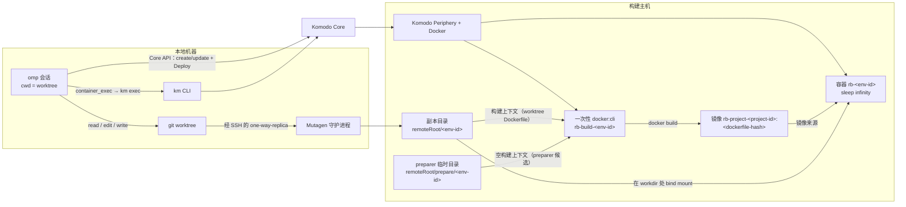
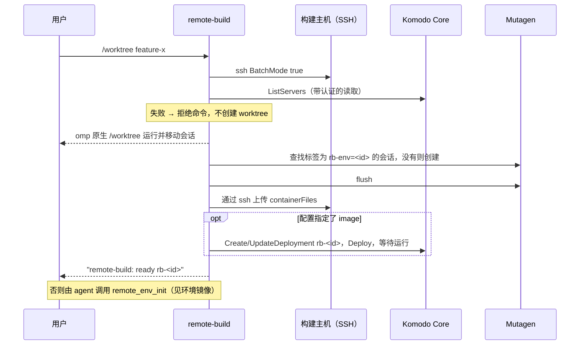

# omp-remote-build

[English](README.md) | 简体中文

一个 [Oh My Pi（`omp`）](https://github.com/can1357/oh-my-pi) 插件，为每个 git worktree 在远端 Docker 主机上提供独立的构建/测试环境：

- 一个 **Mutagen one-way-replica** 会话把本地 worktree 镜像到构建主机；
- 一个 **Komodo Deployment** 在该主机上运行一个长期存在的容器，副本以 bind mount 挂载为它的工作目录；
- 一个**项目镜像**装着项目的工具链和依赖：配置里指定的现成镜像、worktree 里的 Dockerfile，或者由 subagent 一次性准备、以 `.omp/remote-build.Dockerfile` 发布到仓库里的 Arch Linux 镜像。构建主机只缓存构建好的镜像，以 Dockerfile 内容为键，Dockerfile 相同的 worktree 都复用它们；
- **`remote_env_init`** 用该镜像准备 worktree 的容器，并运行项目的 bootstrap 命令；
- 四个 **`container_*` 工具**让 agent 在该容器里使用交互式 PTY。

agent 继续用常规工具在本地编辑文件，通过容器工具在远端机器上编译、测试和运行。每次可能改动文件的工具调用之后都会做一次 Mutagen flush，让容器在 agent 下一步之前看到改动。

项目用一个文件 `.omp/remote-build.json` 选择加入。没有这个文件的项目永远不会被触碰。

## 工作原理



### 环境生命周期



- **身份。** 一个环境属于一个绝对路径的 worktree 根。它的 id 是 `<slug>-<hash>`：目录名生成的 slug，加上规范根路径 SHA-256 的 10 个十六进制字符。Mutagen 会话叫 `rb-<id>`，带标签 `remote-build` 和 `rb-env=<id>`。副本位于 `<remoteRoot>/<id>`，Komodo Deployment 和它的容器都叫 `rb-<id>`。一个项目是同一仓库的所有 worktree；项目 id 用同样方法从主检出的路径得出。项目镜像的标签是 `rb-project-<project-id>:<Dockerfile SHA-256 的前 16 个十六进制字符>`，所以已存在的标签必然是这份 Dockerfile 的构建结果。
- **权威。** 仓库拥有环境定义：`.omp/remote-build.json` 和它指定的 Dockerfile，包括准备好的 `.omp/remote-build.Dockerfile`。会话是否存在由 Mutagen 守护进程决定（按标签查找），Deployment 是否存在并在运行由 Komodo Core 决定，镜像是否存在由构建主机的 Docker 守护进程决定。构建好的镜像只是缓存：构建主机会清理没有容器使用的镜像，插件会从 Dockerfile 重建缺失的镜像。插件在构建主机上不保存自己的状态。重新准备是幂等的：已有会话会被复用，托管字段已匹配且容器在运行的 Deployment 保持不动，发生漂移的会被更新并重新部署。
- **何时准备环境：**
  - `/worktree`（或 `/wt`）把会话移到一个已选择加入项目的新 worktree 之后；
  - 在一个已有 Mutagen 会话的非主 worktree 里开始会话时（在那里重新打开或恢复会话）；
  - **隔离 subagent**（带 `isolated: true` 的 `task`）开始会话时，它独立的工作区会得到自己的环境；
  - 在已选择加入项目的某个 worktree 里，本会话还没有环境时，第一次调用 `remote_env_init` 或 `container_*` 工具。
  主检出从不获得环境；远端环境是 worktree 的功能。准备会同步 worktree，如果配置了 `image`，还会确保容器存在。镜像来源是其他情况时，容器归 `remote_env_init` 管。
- **门控。** 环境处于 `preparing` 时，该 worktree 里的每个工具调用都会等待它。准备 `failed` 时，那里的每个工具调用都被拦截，错误作为拦截原因返回。修复原因后重启会话。
- **flush。** 每个工具结果之后，插件都会执行 `mutagen sync flush`，除非该工具已知不写文件：`read`、`grep`、`glob`、`ast_grep`、`web_search`、`todo`、`ask`、`ctx`、`wait`、四个 `container_*` 工具，以及 `remote_env_build_image`（它只在构建主机上构建）。其他工具（`edit`、`write`、`eval`、`exec_command`、`bash`、`task`、`remote_env_init` 等）都算作可能写入，因为它们的副作用未知，或者对 `remote_env_init` 来说，因为它会发布准备好的文件。

### 环境镜像

`remote_env_init` 解析项目镜像，用它重建 worktree 容器 `rb-<id>`，并运行 bootstrap 命令。每次调用它都会从 `.omp/remote-build.json` 读取 `image`、`dockerfile` 和 `bootstrap`；其他字段保持环境准备时的值，直到下一个会话。

|来源|条件|镜像|
|---|---|---|
|配置|配置设置了 `image`|直接使用该镜像，从不构建|
|worktree Dockerfile|配置的 `dockerfile`，否则为 worktree 里 `.devcontainer/Dockerfile`、`Dockerfile` 中第一个存在的普通文件|`rb-project-<project-id>:<hash>`：标签存在时复用，否则以同步过去的 worktree 副本为构建上下文构建|
|preparer subagent|worktree 里没有 Dockerfile|由 subagent 准备，并作为 worktree Dockerfile `.omp/remote-build.Dockerfile` 发布，见下文|

`rebuild: "image"` 即使标签已存在也会构建 Dockerfile，例如上游软件包更新之后。`rebuild: "prepare"` 重新运行 preparer 并替换 `.omp/remote-build.Dockerfile`；worktree Dockerfile 是手写的时候会被拒绝。修改 Dockerfile 不需要这两者：内容哈希不同就是不同的标签，下一次调用时构建。

之后每次调用都会从镜像重建容器（已打开的容器会话会结束）；如果配置设置了 `bootstrap`，就在一个一次性容器 `rb-boot-<id>` 的工作目录里用 `<shell> -c` 运行它，该容器有相同的挂载和环境变量。它用于挂载目录内按 worktree 区分的状态，例如 `bun install`，必须是幂等的。

**构建。** Periphery 运行在一个看不到 `remoteRoot` 的容器里，所以镜像构建不使用 Komodo Builds。每次构建都是一个 `docker:cli` 的一次性 Deployment，名为 `rb-build-<id>`，它挂载主机的 Docker socket 和构建上下文，运行 `docker build`。当 Dockerfile 的某个阶段是 `FROM rb-base-archlinux:latest` 而该镜像缺失时（它和其他未使用的镜像一样会被清理），插件先用 [`images/archlinux.Dockerfile`](images/archlinux.Dockerfile) 构建它：带 `base-devel`、`git`、`sudo` 和 `paru` 的 Arch Linux。构建和 bootstrap 容器以重启策略 `no` 运行一次，它们的 Deployment 会被下一次运行复用。

**Preparer subagent。** 没有 Dockerfile 时，`remote_env_init` 确保基础镜像存在，用它部署 worktree 容器，并以会话的模型在 worktree 里运行一个 `remote-env-preparer` subagent。subagent 阅读项目、在容器里试验，然后调用 `remote_env_build_image`，传入一个最终阶段为 `FROM rb-base-archlinux:latest`、不含 `COPY` 或 `ADD` 的 Dockerfile，以及一条 bootstrap 命令。它用 `pacman` 安装官方软件包，用 `paru` 安装 AUR 软件包，有 `-bin` 版本时一律选它。`remote_env_build_image` 从一个空的临时上下文 `<remoteRoot>/prepare/<id>/` 构建候选镜像，用它重建容器并运行 bootstrap 命令；最后一个成功的候选保留在该临时目录里。项目的构建和测试在该容器里通过后，subagent 结束。只有当它的最终回答写明 `result: success` 时，`remote_env_init` 才会发布到 worktree，每个文件都通过原子 rename 写入，配置最后写：

|文件|内容|
|---|---|
|`.omp/remote-build.Dockerfile`|最后一个成功的候选 Dockerfile，逐字节相同，所以它的标签就是已经构建好的镜像|
|`.omp/remote-build.preparer.md`|subagent 的最终回答，开头是它所描述的 Dockerfile 的 SHA-256|
|`.omp/remote-build.json`|`dockerfile` 设为 `.omp/remote-build.Dockerfile`，`bootstrap` 设置或移除；其他字段保留，以 2 空格缩进的 JSON 重写|

之后会删除临时目录。请提交这三个文件：有它们的 worktree 和构建主机会直接复用或据此重建镜像，无需再次准备。检出时没有这些文件的 worktree（例如来自尚未合并这些文件的分支）会自己运行 preparer。之后的报告会展示 `.omp/remote-build.preparer.md`，并在报告写成后 Dockerfile 又有改动时加一条 `note`。`remote_env_build_image` 只对 preparer 可用，preparer 不能调用 `remote_env_init`。

**报告。** `remote_env_init` 以 `key: value` 行的形式给 agent 返回：`status`（`ready` 或 `failed`）、`worktree`、`project`、`container`、`image`、`image_source`、`persisted`、`base_image`、`note`、`build_output_tail`、`bootstrap`、`bootstrap_exit_code`、`bootstrap_output_tail`、`preparer_report`、`usage`，失败时还有 `error`。不适用的字段省略。输出尾部截断到 80 行或 8 KiB。失败的 init 以工具错误返回同样的报告，所以每个已完成的步骤都可见。

### 同步什么

副本是单向的：本地 → 远端。容器创建的文件（构建输出、缓存）留在远端，从不回传。`.git` 从不同步。git 生效的忽略来源会转换成 Mutagen 忽略模式：`core.excludesFile`（默认 `$XDG_CONFIG_HOME/git/ignore`）、`.git/info/exclude`，以及未被忽略目录里的每个 `.gitignore`，并遵守 `core.ignoreCase`。匹配忽略规则的已跟踪文件仍会同步。因此被忽略的构建输出不会传过去，而是在容器里重新构建。此外：

- `ignore` 追加 Mutagen 模式；
- `include` 重新包含 git 忽略但容器需要的路径；
- `containerFiles` 的目标被排除在同步之外，单独上传，所以一个文件可以只存在于远端（例如容器专用的工具配置）。

忽略集合在创建 Mutagen 会话时固定。修改忽略规则后，终止该会话（见[清理](#清理)），下一次准备时会重新创建。

## 要求

|组件|说明|
|---|---|
|`omp`|插件从 `~/.omp/plugins` 加载。基于 `@oh-my-pi/pi-coding-agent` 18.6 开发。|
|[`omp-unified-exec`](https://github.com/oh-my-omp/omp-unified-exec)|作为 omp 插件安装。容器工具复用它当前的 `ExecSession` API、渲染后的终端观察和转义解码，以 `omp-unified-exec/src/*` 导入，所以必须以这个名字安装在本插件旁边。|
|可用的 PTY 后端|omp 宿主必须提供 Bun 原生的 `Bun.Terminal`。`container_exec` 在检查或打开容器终端之前调用 `omp-unified-exec` 的运行时准入检查；宿主缺少该能力时，报告 `Container PTY unavailable` 及运行时要求，插件的其余部分照常工作。|
|[Mutagen](https://mutagen.io)|本地有 `mutagen` CLI。它的守护进程按需启动，通过 SSH 连到构建主机并自动在那里安装 agent。|
|SSH|对构建主机有非交互、基于密钥的访问（`ssh -o BatchMode=yes <host> true` 必须成功）。|
|[Komodo](https://komo.do) Core + Periphery|本地机器能访问 Core。构建主机注册为 Komodo **Server**，运行着 Periphery，并有可用的 Docker 守护进程。基于 Komodo v2.2 开发。|
|`km`（komodo-cli）|用于容器终端（`km exec`）。它的配置文件还提供插件使用的 Core URL 和 API 凭据，两条路径共用一个来源。|
|`git`、Bun|`git` 用于发现 worktree 和转换忽略规则。Bun 随 omp 提供。|
|构建主机可访问镜像仓库和 AUR|镜像构建会拉取 `docker:cli`、Dockerfile 里指定的镜像和 `archlinux:latest`；基础镜像从 AUR 克隆 `paru` 并编译（`paru-bin` 二进制链接的 `libalpm` 比当前 pacman 附带的旧）。|

**Komodo 权限。** km profile 里的 API key 必须能读取 Servers、Deployments 和 Updates；在构建主机的 Server 上查看 Docker 镜像和容器、读取容器日志；创建和更新 Deployments；执行 `Deploy`；并在该 Server 上打开容器终端。

## 安装

```bash
omp install https://github.com/oh-my-omp/omp-unified-exec   # 依赖，装一次
omp install https://github.com/oh-my-omp/omp-remote-build
```

从 GitHub 安装会跟随默认分支；更新时重新执行同一条 `omp install <url>`。安装或更新后重启 `omp`。

然后创建下文描述的两个配置文件，并重启 `omp`。

## UI 语言

面向用户的标签、状态和通知在 `OMOMP_LANG` 为 `en` 或 `zh`（不区分大小写）时使用该值。否则使用 `LC_ALL`、`LC_MESSAGES`、`LANG` 中第一个非空值（以 `zh` 开头时使用中文，否则使用英文）；都没有时默认为英文。

在 omp 会话中，这个 OMP-only 插件还会在 `OMOMP_LANG` 不是受支持的值时，从 omp agent 目录中唯一的 `omomp.yml`、`omomp.yaml`、`omomp.json` 或 `omomp.toml` 文件读取 `omomp-lang`：

```yaml
omomp-lang:
  language: zh
```

插件在第一次需要该设置时读取文件一次；设置从下一次启动 omp 起生效。

## 配置

### 1. 主机配置（每个用户）：`~/.omp/agent/remote-build.json`

文件位于 omp 的 agent 目录：默认 `~/.omp/agent`，或当前 profile 下 omp agent 目录指向的位置。它描述唯一的构建主机。每次检查都会重新读取，所以修改无需重启 omp 即生效。示例见 [`examples/remote-build.host.json`](examples/remote-build.host.json)：

```json
{
  "ssh": "build-host",
  "remoteRoot": "/srv/remote-build",
  "komodo": {
    "profile": "build",
    "server": "build-host",
    "cliConfig": "~/.config/komodo/komodo.cli.toml"
  },
  "bin": {
    "km": "km",
    "mutagen": "mutagen"
  }
}
```

|字段|必填|默认值|含义|
|---|---|---|---|
|`ssh`|是|—|构建主机的 SSH 目标：`~/.ssh/config` 里的别名或 `user@host`。供 `ssh` 使用，也作为 Mutagen 的 beta 端点（`<ssh>:<remoteRoot>/<id>`）。|
|`remoteRoot`|是|—|构建主机上的绝对目录，每个环境在其中有一份副本。Periphery 管理的 Docker 守护进程会 bind mount 它下面的路径，所以它必须是该守护进程能访问的主机路径。|
|`komodo.profile`|是|—|`komodo.cliConfig` 中 `[[profile]]` 的 `name` 或它的某个 `aliases`。|
|`komodo.server`|是|—|运行容器的 Komodo Server（Periphery）名称。|
|`komodo.cliConfig`|否|`~/.config/komodo/komodo.cli.toml`|km CLI 配置文件。开头的 `~/` 会被展开。必须是单个文件：不复现 km 的目录、关键字和环境变量配置合并。|
|`bin.km`|否|`km`|km 可执行文件。裸名称通过 `PATH` 解析。如果 omp 启动时没有你 shell 的 `PATH`，请用绝对路径。|
|`bin.mutagen`|否|`mutagen`|Mutagen 可执行文件，解析规则相同。|

未知字段会被拒绝。

引用的 km profile 形如下例。插件读取 `host`、`key` 和 `secret`，从不打印它们：

```toml
[[profile]]
name = "build"
host = "https://komodo.example.com"
key = "K-..."
secret = "S-..."
```

### 2. 项目选择加入（每个仓库）：`.omp/remote-build.json`

把它提交到仓库根目录，仓库的每个 worktree 就都带有它。示例见 [`examples/project.remote-build.json`](examples/project.remote-build.json)：

```json
{
  "image": "rust:1-bookworm",
  "workdir": "/workspace",
  "shell": "bash",
  "ignore": ["*.log"],
  "include": [".env.build"],
  "containerFiles": {
    ".cargo/config.toml": ".omp/container-cargo-config.toml"
  },
  "volumes": ["rb-cargo-registry:/usr/local/cargo/registry"],
  "env": {
    "CARGO_TARGET_DIR": "/workspace/target"
  }
}
```

|字段|必填|默认值|含义|
|---|---|---|---|
|`image`|否|—|构建/测试容器的现成镜像。准备环境时自动部署容器，`remote_env_init` 会重新部署它。与 `dockerfile` 互斥。|
|`dockerfile`|否|依次探测 `.devcontainer/Dockerfile`、`Dockerfile`|项目镜像的 Dockerfile（相对仓库路径），由 `remote_env_init` 以 worktree 为上下文构建。没有 `image`、`dockerfile`，worktree 里也没有 Dockerfile 时，由 subagent 准备镜像，并把此字段设为 `.omp/remote-build.Dockerfile`（见[环境镜像](#环境镜像)）。|
|`bootstrap`|否|无|单行 shell 命令，每次 `remote_env_init` 部署后在一个新容器的工作目录里用 `<shell> -c` 运行，例如 `bun install`。准备出的镜像会把它设为 preparer 的命令。|
|`workdir`|否|`/workspace`|副本在容器内的挂载点（绝对路径），也是容器的工作目录。|
|`shell`|否|`bash`|`container_exec` 在容器里启动、并用来运行 `bootstrap` 的程序；镜像里必须有它。|
|`ignore`|否|`[]`|额外的 Mutagen 忽略模式（Mutagen 语法，相对 worktree 根），在转换后的 git 忽略规则之后应用。|
|`include`|否|`[]`|被 git 忽略但仍需同步的相对仓库路径。|
|`containerFiles`|否|`{}`|*远端目标* → *本地来源* 的映射，都是相对仓库路径。每个目标都排除在同步之外，每次准备时把来源文件的内容上传到目标。|
|`volumes`|否|`[]`|额外的 `docker run -v` 规格（`host-or-volume:container[:mode]`），通常是在多个环境间共享的命名缓存卷。|
|`env`|否|`{}`|额外的容器环境变量。|

相对路径不能是绝对路径，也不能包含 `..`；未知字段会被拒绝。由于 Komodo 键值解析器的限制，`volumes` 和 `env` 的值不能包含 CR、LF、NUL 或 ` #` 序列。

容器以重启策略 `unless-stopped` 运行 `sleep infinity`。所有工作都通过 PTY 工具进行。

## 用法

1. 在一个已选择加入的仓库里启动 `omp`，执行 `/worktree <branch>`（或 `/wt`）。插件先检查 SSH 和 Komodo；任一失败，命令会报错并被拒绝，不会创建 worktree。
2. omp 创建 worktree 并把会话移进去。状态栏显示 `remote-build: preparing <root>`，直到出现 `remote-build: ready rb-<id>` 通知。在此期间的工具调用会等待。
3. 除非配置指定了 `image`，agent 在第一次 `container_exec` 之前调用 `remote_env_init`；对没有运行的容器调用 `container_exec` 会失败，并提示调用它。依赖变化后，agent 修改 Dockerfile（准备出来的 Dockerfile 则以 `rebuild: "prepare"` 调用 `remote_env_init`），再调用一次 `remote_env_init`。请提交 preparer 运行发布的文件。
4. agent 照常在本地编辑，用容器工具构建和测试：

|工具|作用|
|---|---|
|`remote_env_init`|解析项目镜像，用它重建 worktree 容器并运行 bootstrap 命令；返回[环境镜像](#环境镜像)中描述的报告。`rebuild: "image"` 从 worktree Dockerfile 重建镜像；`rebuild: "prepare"` 重新运行 preparer。|
|`container_exec`|在当前 worktree 的容器里打开一个运行 `shell` 的 PTY，可附带初始输入（会解码 `\n`、`\x03`、`\x1b` 等 C 风格转义；不会追加换行）。返回一个 `session_id`，以及 `yield_time_ms`（默认 10 s，范围 0.25–30 s）内收集到的输出。|
|`container_write_stdin`|向已有会话发送输入，或轮询它（不传 `chars`）。等待窗口默认 250 ms。|
|`container_list_sessions`|列出本环境的 PTY 会话，包括最终输出尚未被轮询的已结束会话。|
|`container_kill_session`|终止本地 `km` 客户端（SIGTERM，2 s 后 SIGKILL）。这不会停止容器，远端 shell 可能比它活得久；优先发送 `exit\n`。|

这些工具和 preparer 专用的 `remote_env_build_image` 只在能运行的地方启用：已选择加入的项目里、`.omp/remote-build.json` 能正确解析的 linked worktree。其他地方（包括主检出）插件会在会话开始时停用它们，不占提示词。preparer 得到容器工具和 `remote_env_build_image`；其他会话得到容器工具和 `remote_env_init`。`/worktree`、`/wt` 或 `/move` 移动会话后，以及每轮 agent 开始前，插件都会重新判断，且只改动自己的工具。在这类 worktree 里开始的会话以 `xd://` 设备呈现它们；移动后才启用的工具以顶层工具呈现，因为 omp 的 `setActiveTools` 把新启用的工具放在顶层。

`km exec` 本身总是以 0 退出，所以传输层的退出码不能说明你的命令结果。请从 shell 里读取命令结果，例如 `cargo test; echo $?`。会话运行时，每个结果显示渲染后的终端：自上次调用以来滚出屏幕的行，然后是当前屏幕；没有变化时显示 `(screen unchanged since the last call)`。已结束的会话返回不可变的最终活动屏幕。实时更新在输出解析后读取不消费轮询观察的屏幕快照，以 250 ms 节流，并在调用仍附着期间补发尾次更新。输出经过净化，并按 omp 默认的尾部限制截断；完整记录保存在会话的 `log_path`。会话限定在当前 cwd 的环境内。轮询已结束会话的最终输出或终止会话时，先释放终端再移除会话；omp 关闭时终止所有剩余的本地传输并释放其活动终端。

## 清理

插件只创建资源、从不删除，所以删除 worktree 会留下它的环境。要删除一个环境：

```bash
mutagen sync list --label-selector=remote-build      # 找到 rb-<id>
mutagen sync terminate rb-<id>
# Komodo：删除 Deployment rb-<id>、rb-boot-<id> 和 rb-build-<id>（UI 或 API），这会删除它们的容器
# 容器以 root 运行，所以它们在副本里创建的文件（node_modules 等 bootstrap 输出）属于 root：
ssh <host> docker run --rm -v <remoteRoot>:/rb archlinux:latest rm -rf /rb/<id>
```

项目镜像无需清理：没有容器使用它们后，构建主机的镜像清理会删除它们，下一次 `remote_env_init` 从仓库的 Dockerfile 重建。基础镜像 `rb-base-archlinux:latest` 也一样。`<remoteRoot>/base/archlinux` 存放它的构建上下文，`<remoteRoot>/prepare/<id>` 存放一次 preparer 运行的临时上下文；两者都会被下一次需要它们的运行重写。

`volumes` 里列出的命名卷在环境之间共享，不属于任何单个环境。

## 安全说明

- 凭据只来自你指定的 km CLI 配置文件。解析错误的报告不回显文件内容；Komodo 的错误响应体会被丢弃而不展示，因为其中可能回显环境变量的值。
- Deployment 以 `skip_secret_interp: true` 创建，所以 Komodo 不会把它的 secret 变量插值到容器配置里。
- `env` 的值以明文出现在 Komodo Deployment 配置里，不要在那里放 secret。

## 限制

- 每份用户配置只有一个构建主机；不支持按项目选择主机。
- 副本是单向的。远端的改动（生成的文件、在容器里运行的格式化输出、`bootstrap` 创建的文件）不会同步回来。
- 每次非只读工具调用后的 flush 都会给该调用增加一次同步往返。
- Mutagen 忽略集合在会话创建时固定。
- 没有自动拆除（见[清理](#清理)）。
- `container_*` 工具需要 omp 宿主提供原生 `Bun.Terminal`。
- 每次 `remote_env_init` 都会重建容器，这会结束已打开的容器会话，并丢弃容器里写在挂载目录之外的内容。
- 镜像只以 Dockerfile 内容为键。会 `COPY` 变化中的构建上下文文件，或其 `RUN` 步骤拉取不断更新的上游软件包的 Dockerfile，需要 `rebuild: "image"` 才能拿到这些变化。
- 构建主机的镜像清理可能在两次会话之间删除项目镜像；下一次 `remote_env_init` 会重建它，需要一次构建的时间。基础镜像也以同样方式重建，所以对 [`images/archlinux.Dockerfile`](images/archlinux.Dockerfile) 的修改要等旧镜像被清理或删除后才会到达构建主机。
- 准备好的 Dockerfile 只能经由 git 到达其他 worktree：检出时没有已发布文件的 worktree 会再次运行 preparer。

## 开发

```bash
bun install
bunx tsc --noEmit -p .
```

开发依赖 `omp-unified-exec` 提供类型检查和用 `omp -e src/index.ts` 从本检出加载插件时使用的 API。该 API 更新后执行 `bun update omp-unified-exec`。运行时，已安装的插件使用作为 omp 插件安装的那份副本。要针对本地 unified-exec 检出做检查时，临时让开发依赖解析到该检出，完成类型检查后恢复依赖解析，不提交此临时改动。

`src/komodo.ts` 是唯一的容器后端边界：`komodoReachable`、`ensureContainer`、`runOnce`、`buildImage`、`imageExists`、`containerRunning` 和 `execArgv`。其他模块都不构造 Komodo 请求或 `km` argv。

## 许可

MIT
